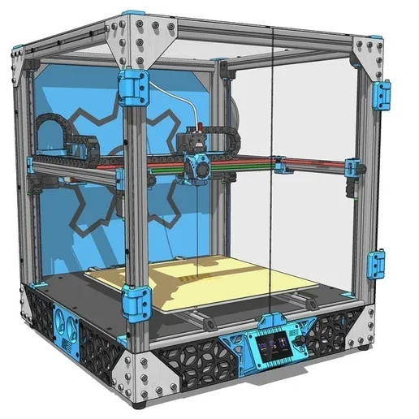

# Project Journal

This journal explains what I worked on and why I made each choice. I use simple words so anyone can understand the project.

> **Image note:** The image in these entries is the same overall MY-CoreXY design reference. It helps explain what the printer should look like. It is not a photo of a finished printer or proof that the parts have been built.

## 30 October 2026 — Starting the project

**What I did:** I started planning my own build of the MY-CoreXY 3D printer. I began looking at the design and the electronics needed for it.

**Why I chose this printer:** I wanted to build a CoreXY printer because its print head moves in the X and Y directions using a belt system. The printer also has a moving gantry for the Z direction.

**My decisions:**
- **Use the MY-CoreXY design as the starting point:** This gives me a known design to study instead of inventing every part from zero.
- **Keep the original CoreXY layout:** I want to understand and follow the design before making changes.
- **Plan before buying parts:** This should help me avoid buying parts that do not fit together.

**Status:** This was the planning stage. The printer was not built.

## 3 November 2026 — Looking at CAD software and source files

**What I did:** I looked into OpenSCAD and searched for the original printer model files.

**Why I looked at OpenSCAD:** I wanted a free tool to learn about 3D models and see how parts are made.

**My decisions:**
- **Use free tools where possible:** I want to keep the project cost low.
- **Start with the original model files:** They help me understand the shape and purpose of each printed part.
- **Do not assume the files are a complete assembly:** Individual STL parts still need to be placed and checked together.

**Status:** I was studying the files and tools. I had not verified a complete working CAD assembly.

## 6 November 2026 — Trying Onshape and arranging parts

**What I did:** I used Onshape to work with CAD parts and began arranging the model.

**Why I tried Onshape:** It runs in a web browser, so I can work on CAD without needing a powerful computer or installing a large CAD program.

**My decisions:**
- **Try browser-based CAD:** This is easier to access on my current computer.
- **Keep the original parts:** I do not want to change their shape without understanding how they fit.
- **Treat the model as a reference until checked:** A model that looks assembled may still have parts in the wrong place or parts that do not fit.

**Status:** CAD exploration only. The assembly has not been mechanically tested or confirmed ready to build.

## 7 November 2026 — Organising the project and parts list

**What I did:** I organised the project files and worked on the BOM (Bill of Materials). A BOM is a list of everything needed to build the printer.

**My decisions:**
- **Make a separate list for small hardware:** Screws, nuts, washers, spacers, inserts and cable ties are easy to forget, but they are needed for assembly.
- **Keep prices marked as unknown until checked:** I do not want to guess prices and show them as real quotes.
- **Look for suppliers in India:** This will make it easier to buy the parts and understand delivery costs.
- **Keep the folders organised:** This should make the project easier for other people to review.
- **Be honest about unfinished work:** I will mark CAD, wiring and firmware as unfinished until they are actually ready.

**Status:** The project documents and early parts lists are in progress. The final prices, complete verified STEP assembly, electronics documentation and firmware still need work.

## Next steps

1. Check every part and its quantity against the original design.
2. Find Indian supplier links and current prices for each part.
3. Calculate a total that includes small hardware and delivery where possible.
4. Finish and check the full CAD assembly before calling it a complete STEP model.
5. Confirm the controller and electronics before making the wiring plan.
6. Add real screenshots and photos as the project moves forward.
7. Test the printer safely with suitable adult supervision, especially for power-related work.

I will add a new dated entry when I make real progress. I will not use an old image to pretend that a later stage has already been completed.

### 7 November 2026 — Choosing a controller board

**What I did:** I changed the planned controller to the BIGTREETECH SKR Mini E3 V3.0 and updated the project BOM and electronics notes.

**Why I chose it:** It has onboard TMC2209 motor-driver interfaces and documented Klipper support, so separate driver modules are not included in the current estimate.

**What still needs checking:** The original MY-CoreXY files do not agree about the Z-motor arrangement. I need to confirm the number of independently controlled motors before I can say this board is compatible or buy it.

**Status:** The board is the selected budget candidate, not a tested or confirmed final choice.

### 7 November 2026 — Checking the Z-axis motor count

**What I checked:** I reviewed the official MY-CoreXY Z-drive assembly guide.

**What I found:** It describes four Z-drive assemblies, each with a motor. The selected SKR Mini E3 V3.0 has two Z driver channels, so I cannot assume it can independently control all four Z motors.

**My decision:** Keep the board as a candidate only. I need confirmation of the original motor grouping and driver requirements before buying it.

**Status:** Four physical Z-drive motors are confirmed from the assembly guide; the controller arrangement is still unverified.

## 23 November 2026 — Cleaning the BOM and checking the project budget

**What I worked on:** I reviewed the master Bill of Materials (BOM) for my MY-CoreXY 3D printer and cleaned the list so it focuses on purchased components. I also checked how prices are counted, because the same group of parts can accidentally be included more than once.

**Removing optional items:** I removed features that are not needed for the first version: the USB monitoring camera and its holder, touchscreen and mounting hardware, filament-runout sensor, LED strip, optional 0.6 mm and 0.8 mm nozzles, and the AI monitoring software placeholder. I also removed zero-quantity entries for separate stepper-driver modules and a separate 5 V power supply. The proposed controller has onboard driver interfaces, while the accessory list refers to a DC-DC converter for 5 V. These decisions still need checking against the final electronics design.

**Excluding printed-part costs:** I decided that the active BOM should list purchased components only. I removed the printed-part entries and separate printing-cost worksheet from the active budget. Filament, printing electricity and printing time are excluded. This does not mean the printer can work without printed parts. Those parts will still be needed, but their production costs are outside this version of the budget.

**Fixing duplicate prices:** The BOM contained broad category allowances for the frame, motion system, drive system, toolhead, build platform and fasteners. It also listed detailed components belonging to those groups. Adding both the allowance and its component prices could count the same items twice. I kept the category rows as headings and cleared their prices, leaving the detailed component estimates to be counted once. Notes about uncertain prices and quantities remain in the file.

**Budget result:** After clearing the overlapping category prices, I recalculated the priced purchase rows. The current provisional subtotal is **$665.62 USD**, approximately **₹61,675** using the project's reference conversion of ₹92.68 per US dollar. The updated BOM has 88 data rows, with 73 rows containing priced quantities. This is an estimate, not a confirmed supplier quotation. Taxes, shipping, availability and seller prices may change the final amount. Items with unknown quantities or incomplete specifications are not included in the calculated subtotal.

**What I learned:** A useful BOM needs more than part names and prices. It must explain whether a price is a group allowance or an individual component price. It should also identify uncertain quantities, compatibility questions and excluded costs. Clear notes make the project easier to review and help prevent double counting.

**What is still unresolved:** The original MY-CoreXY documentation has differences in the frame profile, linear-rail sizes, Z-axis arrangement and heated-bed specification. The proposed SKR Mini E3 V3.0 controller also needs a confirmed motor and driver arrangement. These questions must be checked against the exact CAD revision before ordering. The BOM is not yet purchase-ready. Mains-powered equipment, grounding, fusing and heated-bed electrical arrangements must be reviewed by a qualified adult electrician.

**Next steps:** I will compare quantities with the original CAD and assembly documents, confirm compatible parts, and replace provisional prices with current supplier quotations where possible. I will also compare the repository total with the Hack Club project form and investigate the difference instead of changing prices just to make the totals match. I will add screenshots or photographs only when they show work I have actually completed.

**Status:** The documentation and budget have been cleaned up, but the printer has not been physically built or tested. The next stage is design verification, not claiming that the machine is complete.

