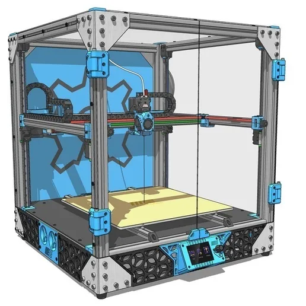

# Project Journal

This journal explains what I worked on and why I made each choice. I use simple words so anyone can understand the project.

> **Image note:** The image in these entries is the same overall MY-CoreXY design reference. It helps explain what the printer should look like. It is not a photo of a finished printer or proof that the parts have been built.

## 30 October 2026 — Starting the project

**What I did:** I started planning my own build of the MY-CoreXY 3D printer. I began looking at the design and the electronics needed for it.

**Why I chose this printer:** I wanted to build a CoreXY printer because its print head moves in the X and Y directions using a belt system. The printer also has a moving gantry for the Z direction.

**My decisions:**
- **Use the MY-CoreXY design as the starting point:** This gives me a known design to study instead of inventing every part from zero.
- **Keep the original CoreXY layout:** I want to understand and follow the design before making changes.
- **Plan before buying parts:** This should help me avoid buying parts that do not fit together.

**Status:** This was the planning stage. The printer was not built.

## 3 November 2026 — Looking at CAD software and source files

**What I did:** I looked into OpenSCAD and searched for the original printer model files.

**Why I looked at OpenSCAD:** I wanted a free tool to learn about 3D models and see how parts are made.

**My decisions:**
- **Use free tools where possible:** I want to keep the project cost low.
- **Start with the original model files:** They help me understand the shape and purpose of each printed part.
- **Do not assume the files are a complete assembly:** Individual STL parts still need to be placed and checked together.

**Status:** I was studying the files and tools. I had not verified a complete working CAD assembly.

## 6 November 2026 — Trying Onshape and arranging parts

**What I did:** I used Onshape to work with CAD parts and began arranging the model.

**Why I tried Onshape:** It runs in a web browser, so I can work on CAD without needing a powerful computer or installing a large CAD program.

**My decisions:**
- **Try browser-based CAD:** This is easier to access on my current computer.
- **Keep the original parts:** I do not want to change their shape without understanding how they fit.
- **Treat the model as a reference until checked:** A model that looks assembled may still have parts in the wrong place or parts that do not fit.

**Status:** CAD exploration only. The assembly has not been mechanically tested or confirmed ready to build.

## 7 November 2026 — Organising the project and parts list

**What I did:** I organised the project files and worked on the BOM (Bill of Materials). A BOM is a list of everything needed to build the printer.

**My decisions:**
- **Make a separate list for small hardware:** Screws, nuts, washers, spacers, inserts and cable ties are easy to forget, but they are needed for assembly.
- **Keep prices marked as unknown until checked:** I do not want to guess prices and show them as real quotes.
- **Look for suppliers in India:** This will make it easier to buy the parts and understand delivery costs.
- **Keep the folders organised:** This should make the project easier for other people to review.
- **Be honest about unfinished work:** I will mark CAD, wiring and firmware as unfinished until they are actually ready.

**Status:** The project documents and early parts lists are in progress. The final prices, complete verified STEP assembly, electronics documentation and firmware still need work.

## Next steps

1. Check every part and its quantity against the original design.
2. Find Indian supplier links and current prices for each part.
3. Calculate a total that includes small hardware and delivery where possible.
4. Finish and check the full CAD assembly before calling it a complete STEP model.
5. Confirm the controller and electronics before making the wiring plan.
6. Add real screenshots and photos as the project moves forward.
7. Test the printer safely with suitable adult supervision, especially for power-related work.

I will add a new dated entry when I make real progress. I will not use an old image to pretend that a later stage has already been completed.

### 7 November 2026 — Choosing a controller board

**What I did:** I changed the planned controller to the BIGTREETECH SKR Mini E3 V3.0 and updated the project BOM and electronics notes.

**Why I chose it:** It has onboard TMC2209 motor-driver interfaces and documented Klipper support, so separate driver modules are not included in the current estimate.

**What still needs checking:** The original MY-CoreXY files do not agree about the Z-motor arrangement. I need to confirm the number of independently controlled motors before I can say this board is compatible or buy it.

**Status:** The board is the selected budget candidate, not a tested or confirmed final choice.
