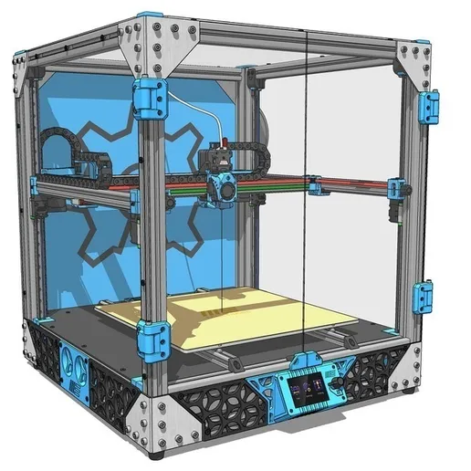

# MY-CoreXY 3D Printer

A student hardware project to build and document a CoreXY 3D printer based on the original **MY-CoreXY** design by EdgarMata.

> **Project status:** Design and planning. The current reconstructed reference assembly is for visual planning only; it is not yet a mechanically validated, manufacturing-ready CAD assembly. Exact part compatibility, dimensions, quantities and supplier prices must be checked before purchasing.

## About

MY-CoreXY is a CoreXY-style 3D printer project based on the design by EdgarMata. The machine uses a rigid aluminium-extrusion frame, belt-driven CoreXY movement for the X/Y axes, a fixed build platform and a gantry that moves along the Z axis. This repository documents the process of understanding the original design, checking its parts and electronics, preparing a bill of materials, and working towards a safe, tested build.

This is an independent student build and learning project, not the official MY-Machines product. The current project is still in the design and planning stage; final dimensions, component choices and assembly details must be verified before construction.

## Project goals

- Build a working CoreXY 3D printer while learning mechanical design, CAD, electronics and fabrication.
- Preserve the original MY-CoreXY architecture: CoreXY XY motion, a fixed build plate and a Z-moving gantry.
- Document the mechanical design, electronics, bill of materials (BOM), assembly and testing.
- Explore a future **CoreXY Guardian** add-on for monitoring vibration and machine condition.

## Design reference and credit

This project is based on the original MY-CoreXY 3D Printer design by **EdgarMata**.

- Original project: https://www.printables.com/model/132032-my-core-xy-3d-printer
- Assembly documentation: https://docs.my-machines.com/3d-printers/my-corexy/assembly/

The original designer and source project are credited. This repository is for documenting my own build planning, learning, testing and clearly identified modifications. Please check the original project's licence and terms before redistributing or manufacturing its files.

## Repository contents

| Path | Contents |
|---|---|
| `BOM.csv` | Master checklist and provisional, unverified budget estimate |
| `Documentation/AUDIT-REPORT.md` | Full source, quantity, cost and evidence audit |
| `CAD/` | CAD models and exports |
| `Images/` | Planned location for design screenshots and build photos |
| `Electronics/` | Planned location for wiring diagrams and controller documentation |
| `Documentation/` | Planned location for design notes, build log and test results |

The CAD folder currently contains `MY-CoreXY.zip` and `MY-CoreXY-Full-Assembly.zip`; it does not contain a verified STEP assembly. Only files that have actually been uploaded are available in this repository.

## Images

### Overall MY-CoreXY design reference

*CAD-style design reference supplied for this project. It shows the intended printer layout; it is not a photograph of a completed build.*

Additional full-model CAD screenshots, electronics layout, schematic and wiring-diagram images will be added when those files are ready. See [Images/](Images/) for image assets and [JOURNAL.md](JOURNAL.md) for dated progress notes.

## Planned materials

The following are material candidates for planning, not a final manufacturing specification. Confirm each material against the original CAD, mechanical loads, operating temperatures and supplier datasheets before ordering.

| Part / subsystem | Candidate material | Notes |
|---|---|---|
| Frame | Aluminium extrusion | Confirm profile, slot type, lengths and wall dimensions from the source design. |
| Linear guides and fasteners | Steel components | Confirm rail size, corrosion protection, screw grades and exact dimensions. |
| Motion belts | Reinforced timing belt | Confirm belt type, width, length and pulley compatibility. |
| Printed covers and non-load-bearing parts | PLA | Suitable only where the part's temperature and mechanical requirements permit. |
| Functional printed brackets and mounts | PETG candidate | Validate strength, creep and temperature suitability for each part before use. |
| Enclosure panels | Material not yet selected | Confirm the original design's panel material, thickness and temperature rating. |
| Wiring insulation and cable management | Rated electrical insulation and suitable clips/ties | Select only after the electrical design and temperature environment are reviewed. |

The BOM includes allowances for filament and small hardware such as M3/M4/M5 screws, nuts, extrusion T-nuts, washers, heat-set inserts, cable ties and clips. Exact quantities and sizes remain to be checked against the final assembly.

## Remaining-parts audit

The master BOM has been expanded with a source-design checklist covering the frame extrusion cut lengths and corner brackets; gantry rails, carriages, belts, pulleys and idlers; Z-motion screw, coupler, rods and bearings; extruder motor, hotend, drive gears, PTFE tube and fittings; bed surface, springs and levelling wheels; enclosure panels, hinges, handle and catches; and accessory items such as the inlet, switch, DC-DC converter, LED strip and nozzles. The electronics BOM also lists the additional electrical/accessory items that still need confirmation.

**Important budget note:** these newly itemised rows have blank prices and are explicitly marked as checklist items pending CAD/revision verification. They are not additional quoted costs and are not included in the current $781.06 estimate. Some are covered by existing broad category allowances, so do not add them to the total a second time until supplier quotations replace the allowances. Optional parts (for example extra nozzles, LED strip, runout sensor and heated-bed alternatives) must be confirmed against the exact machine revision before being treated as required.

The original documentation contains unresolved differences in Z-drive count, bed/power arrangement and accessory configuration. This is a more complete audit checklist, **not yet a purchase-ready or fully priced BOM**.

## Main subsystems

1. **Frame:** aluminium extrusion structure and fasteners.
2. **XY motion:** CoreXY belts, pulleys, idlers, rails and gantry.
3. **Z motion:** Z guides and drive components that move the gantry.
4. **Build platform:** fixed build plate and its support structure.
5. **Toolhead:** compatible extruder and hotend assembly.
6. **Electronics:** controller, motor drivers, power supply, wiring and safety components.

Exact specifications and quantities will be recorded in the BOM after checking the source design and selected components.

## Planned development

- [ ] Verify the CAD assembly against the original design and assembly documentation.
- [ ] Confirm every purchased component's dimensions and compatibility.
- [ ] Complete an item-by-item BOM with supplier quotations and shipping costs.
- [ ] Finalise electronics architecture and wiring documentation.
- [ ] Print and inspect the required plastic parts.
- [ ] Assemble the frame and motion systems.
- [ ] Complete electrical checks and firmware configuration.
- [ ] Run initial motion, calibration and print tests.
- [ ] Document results, problems and improvements.
- [ ] Evaluate the optional CoreXY Guardian monitoring add-on.
- [ ] Integrate a compatible camera for remote print monitoring.
- [ ] Add a compatible touchscreen for local control.
- [ ] Evaluate AI-assisted print-failure detection; treat it as an advisory feature, not a safety system.

## Smart monitoring and user interface — planned features

The planned upgrade set includes a compatible camera for remote viewing, a touchscreen for local status and control, and optional AI-assisted analysis of camera images to flag possible print failures. These features are not yet implemented or validated. AI alerts are advisory only and must never replace supervision, thermal protections or other hardware safety systems.

## CoreXY Guardian — future extension

A possible future feature is a small monitoring system using a microcontroller and vibration sensor to record machine vibration and help identify changes that may indicate maintenance is needed. This is a planned experiment, not a completed or validated safety system.

## Bill of materials (USD planning estimate)

The master checklist is [BOM.csv](BOM.csv) in the repository root. It includes itemised source quantities where available, unpriced checklist rows, preliminary USD estimates and India supplier search links. **It is not purchase-ready.** The official source documents conflict on the frame profile (2020 vs 3030), rail size (MGN9 vs MGN12), Z-motor count/grouping and heated-bed voltage. The product documentation is marked work-in-progress. Read [the full audit report](Documentation/AUDIT-REPORT.md) before making decisions. Mains-powered parts and wiring must be reviewed by a qualified adult electrician.

## Funding and budget

The current arithmetic sum of priced rows is **$761.84 USD** (approximately **₹71,369** at the reference conversion of **1 USD = ₹93.68 on 12 November 2026**). This is **not a verified project budget**: some broad category allowances may overlap with individually priced components, and many required checklist rows are still unpriced. The Electronics BOM is a subsystem view of items already represented in the master BOM; do not add its subtotal again. See [the full audit report](Documentation/AUDIT-REPORT.md). Do not submit this arithmetic sum as a final funding request until the exact design revision, quantities and supplier quotations are confirmed.

Funding would be used only for project materials that are not already available to me. No purchases should be made on the assumption that funding is approved until the programme confirms approval.

## Safety

Mains-powered equipment, heaters and moving machinery can cause injury or fire if assembled incorrectly. Electrical design, fusing, grounding, enclosure and testing must be reviewed carefully, and the printer must not be operated unattended during early testing.

## Build log

Progress updates, CAD revisions, supplier quotations, assembly photographs and test results will be added here as the project develops.

## Electronics planning

- [Preliminary electronics plan](Electronics/ELECTRONICS-PLAN.md)
- [Electronics BOM (unselected parts and quote tracker)](Electronics/ELECTRONICS-BOM.csv)

The planned controller is the **BIGTREETECH SKR Mini E3 V3.0**. It has five onboard TMC2209 driver interfaces and documented Klipper support. This is a replacement candidate, not the original board specified by the MY-CoreXY source. The official assembly guide confirms four Z-drive motors. The board has only two Z driver channels, so the original motor grouping and current requirements must be confirmed before compatibility can be claimed. See [Electronics/ELECTRONICS-PLAN.md](Electronics/ELECTRONICS-PLAN.md).
