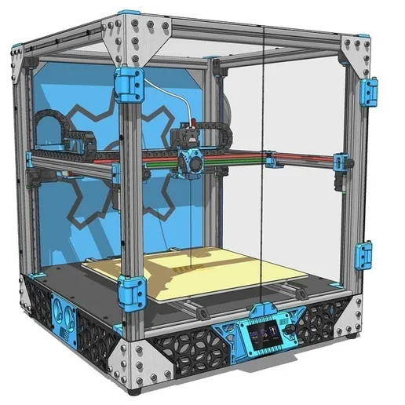

# MY-CoreXY 3D Printer

A student hardware project to build and document a CoreXY 3D printer based on the original **MY-CoreXY** design by EdgarMata.

> **Project status:** Design and planning. The current reconstructed reference assembly is for visual planning only; it is not yet a mechanically validated, manufacturing-ready CAD assembly. Exact part compatibility, dimensions, quantities and supplier prices must be checked before purchasing.

## About
MY-CoreXY is a CoreXY-style 3D printer project based on the design by EdgarMata. This repository documents the process of understanding the original design, checking its parts and electronics, preparing a bill of materials, and working towards a safe, tested build.

This is an independent student build and learning project, not the official MY-Machines product. Final dimensions, component choices and assembly details must be verified before construction.

## Design reference and credit
- Original project: https://www.printables.com/model/132032-my-core-xy-3d-printer
- Assembly documentation: https://docs.my-machines.com/3d-printers/my-corexy/assembly/

The original designer and source project are credited. Check the original project's licence and terms before redistributing or manufacturing its files.

## Repository contents
| Path | Contents |
|---|---|
| `BOM.csv` | Master checklist and provisional parts subtotal |
| `BOM/Printing-Cost.csv` | Separate slicer worksheet; not included in the master subtotal |
| `Documentation/AUDIT-REPORT.md` | Source, quantity, cost and evidence audit |
| `CAD/` | CAD models and exports |
| `Images/` | Design references and build photos |
| `Electronics/` | Wiring and controller planning |

The CAD folder contains `MY-CoreXY.zip` and `MY-CoreXY-Full-Assembly.zip`; it does not contain a verified STEP assembly.

## Design reference image

*Reference image only; not a photograph of a completed build.*

## Materials and printed parts
The BOM lists filament as a required material for printed components, but deliberately leaves its quantity and price blank until the exact printed-part set and slicer estimates are confirmed. No filament price or printing-cost amount is included in the current parts subtotal.

Potential material choices such as PLA and PETG must be checked against each part's temperature and mechanical requirements. Do not assume every printed component can use the same material.

## Important design conflicts
The original documentation has unresolved differences:
- Frame profile: 2020 vs 3030 extrusion.
- Linear rails: MGN9 vs MGN12.
- Z-axis motor arrangement: one motor in one BOM versus four motorised Z-drive assemblies in the assembly guide.
- Heated bed: 24 V PCB bed versus a 240 V bed mentioned in the product overview.
- Controller motor-channel mapping and power-supply sizing are not yet verified.

The master BOM includes unpriced checklist rows where quantities or compatibility still need confirmation. Read [the full audit report](Documentation/AUDIT-REPORT.md) before purchasing. Mains-powered parts and wiring must be reviewed by a qualified adult electrician.

## Budget

**Unit-price update (23 November 2026):** 59 previously blank non-filament component rows in the master BOM now have indicative USD unit-price estimates and supplier reference links. These are planning estimates, not confirmed quotes. Their line totals are intentionally left blank because many parts are already covered by the broad category allowances above; adding them again would double-count the budget. Filament remains unpriced, as requested. Rows with unknown dimensions, unresolved design revision or TBD quantities still need confirmation.

The current master BOM subtotal is **$755.43 USD** (approximately **₹70,013** using the repository's stated reference conversion of 1 USD = ₹92.68). This subtotal excludes filament cost and all printing electricity/labour because the filament row is intentionally unpriced. It retains a **$24.01 unitemized reconciliation allowance** from the earlier user-provided target; that allowance is not a verified component quote. Some broad category allowances may overlap with separately priced parts, and many checklist rows remain unpriced. Treat this as a provisional planning figure, not a purchase-ready quote or complete project cost.

The separate `BOM/Printing-Cost.csv` worksheet is not included in this subtotal. Do not add its estimates until the printed-part list and slicer outputs have been checked and reconciled.

## Safety
Mains-powered equipment, heaters and moving machinery can cause injury or fire if assembled incorrectly. Electrical design, fusing, grounding, enclosure and testing must be reviewed by a qualified adult. Do not operate the printer unattended during early testing.

## Build log
Progress updates, CAD revisions, supplier quotations, assembly photographs and test results will be added as the project develops.
